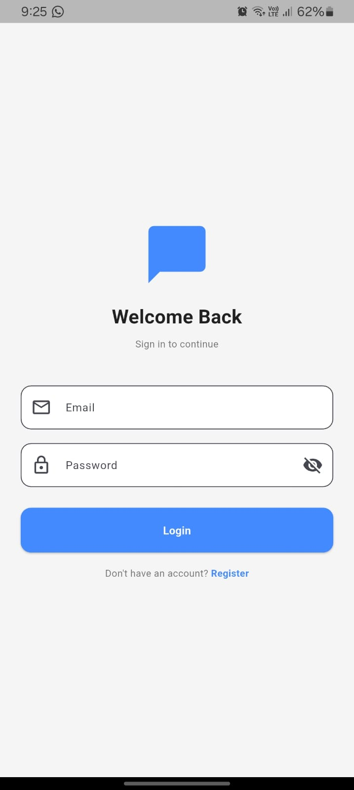
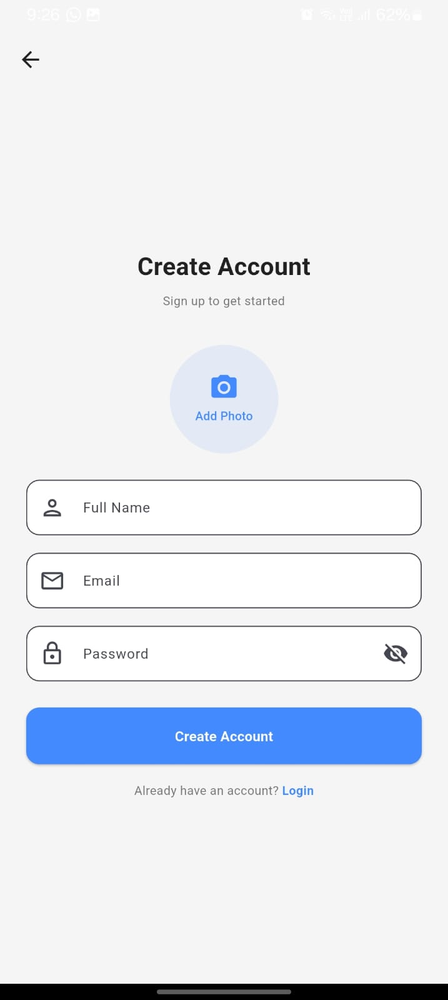
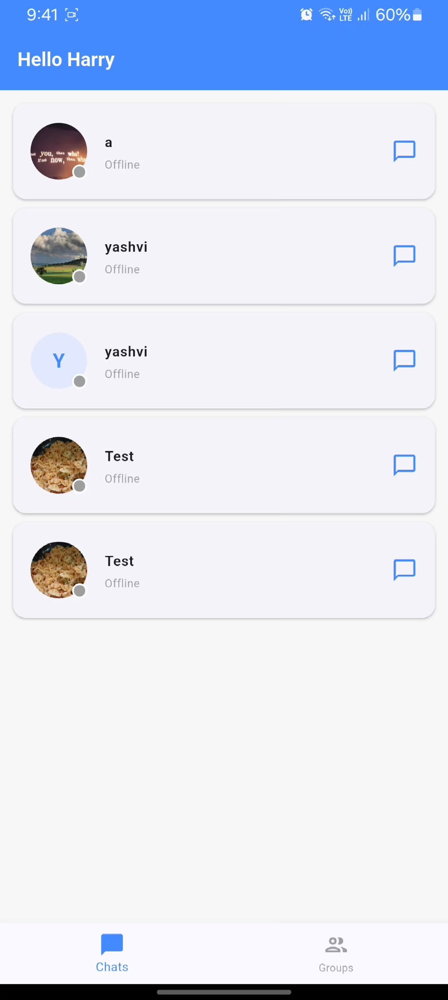
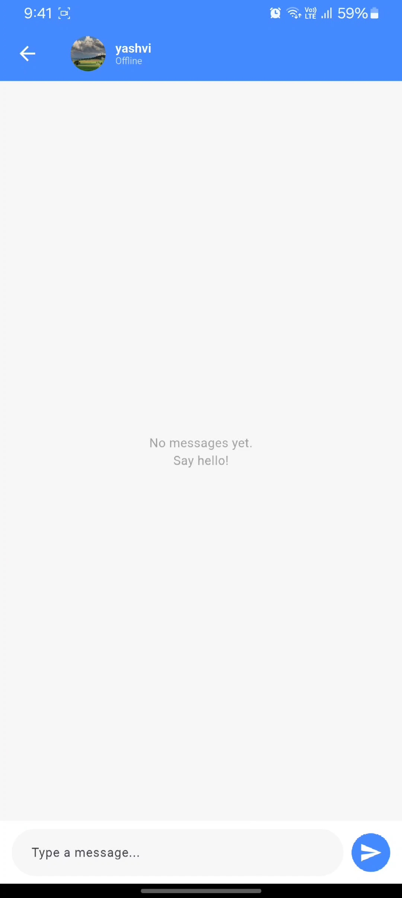
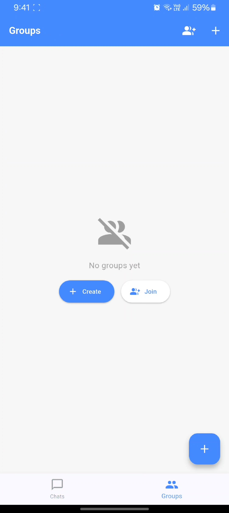
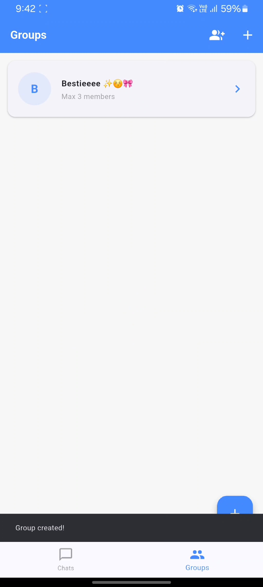
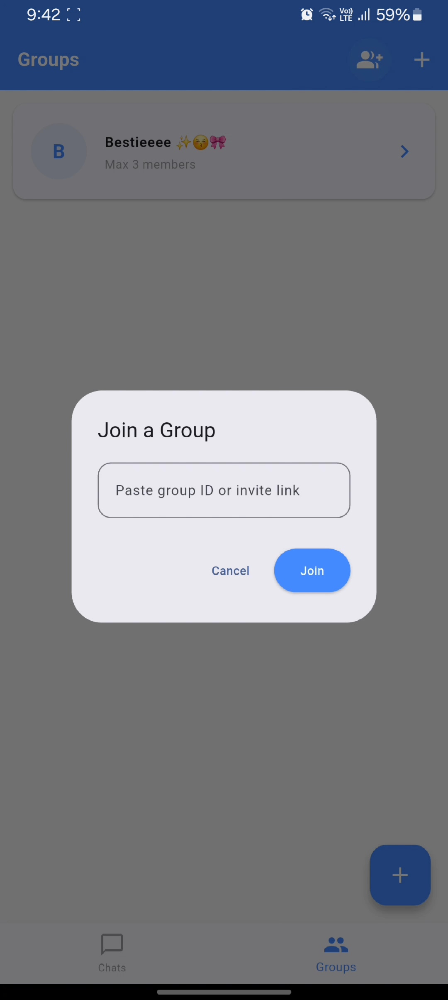

# ChatApp — Real-Time Team Messaging

A full-stack real-time messaging application built with **Node.js**, **Socket.io**, **MongoDB**, and **Flutter**. Supports 1-on-1 direct messages, group chats, online/offline presence, and file sharing.

> Built as a portfolio project to demonstrate full-stack development skills including real-time systems, JWT authentication, cloud deployment, and cross-platform mobile development.

---

## Demo

📱 [Download APK](https://github.com/prachidighe34/chat-app-flutter/releases) &nbsp;|&nbsp; 🌐 [Live Backend](https://chat-app-8ie6.onrender.com) &nbsp;|&nbsp; 🎥 [Demo Video](#)

---

## Screenshots

| Login                            | Register                               | Dashboard                                | Chat                           |
| -------------------------------- | -------------------------------------- | ---------------------------------------- | ------------------------------ |
|  |  |  |  |

| Groups                                  | Group Chat                                     | Invite                             |
| --------------------------------------- | ---------------------------------------------- | ---------------------------------- |
|  |  |  |

---

## Features

- **JWT Authentication** — Secure login/register with access + refresh token rotation
- **Real-time 1-on-1 Chat** — Instant messaging via WebSockets (Socket.io)
- **Group Chat** — Create groups, add members, real-time group messaging
- **Online/Offline Presence** — Live status indicators for all users
- **Edit & Delete Messages** — Full message management in both DMs and groups
- **Invite Links** — Share group invite links; others can join via link or group ID
- **Image Uploads** — Profile and group images via Cloudinary
- **Cross-platform** — Flutter mobile app (Android) + web dashboard (EJS)
- **Dockerized** — Full local setup with docker-compose
- **Cloud Deployed** — Backend on Render, database on MongoDB Atlas

---

## Tech Stack

### Backend

| Technology              | Purpose                           |
| ----------------------- | --------------------------------- |
| Node.js + Express       | REST API server                   |
| Socket.io               | Real-time WebSocket communication |
| MongoDB + Mongoose      | Database                          |
| JWT (jsonwebtoken)      | Authentication                    |
| Cloudinary              | Image storage                     |
| bcrypt                  | Password hashing                  |
| Docker + docker-compose | Containerization                  |

### Frontend (Flutter)

| Package                | Purpose               |
| ---------------------- | --------------------- |
| Dio                    | HTTP client           |
| socket_io_client       | WebSocket connection  |
| flutter_secure_storage | Secure JWT storage    |
| image_picker           | Camera/gallery access |
| provider               | State management      |

### Infrastructure

| Service       | Purpose         |
| ------------- | --------------- |
| Render        | Backend hosting |
| MongoDB Atlas | Cloud database  |
| Cloudinary    | Media CDN       |
| GitHub        | Version control |

---

## Architecture

```
Flutter App (Android)
    │
    ├── REST API (Dio) ──────────────► Node.js + Express
    │                                        │
    └── WebSocket (Socket.io) ──────────────►│
                                             │
                                     ┌───────┴────────┐
                                     │                │
                                  MongoDB          Cloudinary
                                  (Atlas)          (Images)
```

### Socket.io Event Flow

```
Client A sends message
    │
    ▼
Server receives 'newChat'
    │
    ├── Saves to MongoDB
    │
    └── Broadcasts 'loadNewChat' to Client B
            │
            ▼
        Client B receives message in real time
```

---

## Project Structure

### Backend

```
backend/
├── controllers/
│   └── userControllers.js     # All business logic
├── middleware/
│   └── auth.js                # JWT verification middleware
├── models/
│   ├── userModel.js           # User schema
│   ├── chatModel.js           # 1-on-1 message schema
│   ├── groupModel.js          # Group schema
│   ├── memberModal.js         # Group membership schema
│   └── groupChatModel.js      # Group message schema
├── routes/
│   └── userRoute.js           # All API routes
├── helpers/
│   └── cloudinary.js          # Cloudinary upload helper
├── view/                      # EJS templates (web dashboard)
├── app.js                     # Entry point + Socket.io setup
├── Dockerfile
└── docker-compose.yml
```

### Flutter

```
frontend/lib/
├── constants/
│   └── app_constants.dart     # Base URL
├── models/
│   ├── user_model.dart
│   ├── chat_model.dart
│   ├── group_model.dart
│   └── group_chat_model.dart
├── services/
│   ├── api_service.dart       # All HTTP calls + interceptors
│   ├── auth_service.dart      # JWT storage + refresh
│   └── socket_service.dart    # Socket.io event handlers
├── screens/
│   ├── login_screen.dart
│   ├── register_screen.dart
│   ├── home_screen.dart
│   ├── dashboard_screen.dart
│   ├── chat_screen.dart
│   ├── group_screen.dart
│   └── group_chat_screen.dart
└── main.dart
```

---

## API Reference

### Auth

```
POST /register          Register with name, email, password, image
POST /                  Login → returns accessToken + refreshToken
POST /refresh-token     Refresh expired access token
```

### Users

```
GET  /api/users         Get all users except current user
```

### 1-on-1 Chat

```
POST /save-chat         Save a message
POST /delete-chat       Delete a message
POST /update-chat       Edit a message
```

### Groups

```
GET  /groups            Get all groups (created + joined)
POST /groups            Create a new group
POST /get-members       Get group members
POST /add-members       Add/update members
POST /join-group        Join via invite link
GET  /share-group/:id   Group invite page
```

### Group Chat

```
POST /group-save-chat   Send group message
POST /load-group-chats  Load group message history
POST /delete-group-chat Delete group message
POST /update-group-chat Edit group message
```

### Socket.io Events

```
Client → Server:
  newChat           Send 1-on-1 message
  existingChat      Load chat history
  chatDeleted       Delete message
  chatUpdated       Edit message
  newGroupChat      Send group message
  groupChatDeleted  Delete group message
  groupChatUpdated  Edit group message

Server → Client:
  loadNewChat           New 1-on-1 message
  loadChats             Chat history
  loadDeletedChat       Message deleted
  loadUpdatedChat       Message edited
  loadNewGroupChat      New group message
  groupChatMessageDeleted  Group message deleted
  groupChatMessageUpdated  Group message edited
  getOnlineUser         User came online
  getOfflineUser        User went offline
```

---

## Local Setup

### Prerequisites

- Node.js v20+
- Docker + docker-compose
- Flutter SDK
- MongoDB (local or Atlas)

### Backend

**1. Clone the repo:**

```bash
git clone https://github.com/prachidighe34/chat-app.git
cd chat-app
```

**2. Create `.env`:**

```env
MONGO_URI=mongodb://mongo:27017/dynamicChat
SESSION_SECRET=your_session_secret
JWT_SECRET=your_jwt_secret
JWT_REFRESH_SECRET=your_refresh_secret
CLOUDINARY_CLOUD_NAME=your_cloud_name
CLOUDINARY_API_KEY=your_api_key
CLOUDINARY_API_SECRET=your_api_secret
PORT=3000
```

**3. Run with Docker:**

```bash
docker compose up --build
```

Server runs at `http://localhost:3000`

**4. Run without Docker:**

```bash
npm install
node app.js
```

### Flutter App

**1. Clone frontend:**

```bash
git clone https://github.com/prachidighe34/chat-app-flutter.git
cd chat-app-flutter
```

**2. Update base URL in `lib/constants/app_constants.dart`:**

```dart
static const String baseUrl = 'http://10.0.2.2:3000'; // Android emulator
// or
static const String baseUrl = 'http://YOUR_LOCAL_IP:3000'; // Physical device
```

**3. Install dependencies:**

```bash
flutter pub get
```

**4. Run:**

```bash
flutter run
```

---

## Key Technical Decisions

**Why MongoDB over PostgreSQL?**
Messages are append-heavy with flexible schema (reactions, attachments can be added later without migrations). Document model fits chat data naturally. The user/workspace relationships are handled via application-level joins which is sufficient at this scale.

**Why Socket.io over raw WebSockets?**
Socket.io handles reconnection, fallback transports, and room management automatically. For a portfolio project this reduces boilerplate significantly while demonstrating the same real-time concepts.

**Why JWT over sessions for mobile?**
Sessions require cookies which don't work cleanly in Flutter. JWT tokens are stateless, easy to store securely with `flutter_secure_storage`, and work naturally with REST APIs.

**Scaling consideration (interview talking point):**
The current Socket.io setup works on a single server. For horizontal scaling, a Redis adapter (`socket.io-redis`) would be needed so all server instances share the same pub/sub channel. Redis would also pull double duty for caching the user presence map.

---

## Interview Talking Points

- **Real-time architecture** — Socket.io namespaces, room management, broadcast vs emit
- **Auth flow** — JWT access + refresh token rotation, secure storage on mobile
- **Scaling Socket.io** — Redis adapter for multi-instance deployments
- **Database indexing** — compound indexes on `(sender_id, receiver_id)` and `(group_id, createdAt)` for query performance
- **Cursor-based pagination** — why `skip/limit` breaks at scale, how `_id`-based cursors fix it
- **Docker** — multi-container setup, environment parity between dev and prod

---

## Repositories

- **Backend:** [github.com/prachidighe34/chat-app](https://github.com/prachidighe34/chat-app)
- **Frontend:** [github.com/prachidighe34/chat-app-flutter](https://github.com/prachidighe34/chat-app-flutter)

---

## Author

**Prachi Dighe** — Final year CS student, Surat, Gujarat

[](https://github.com/prachidighe34)
